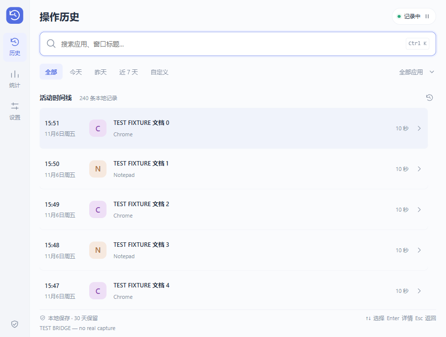
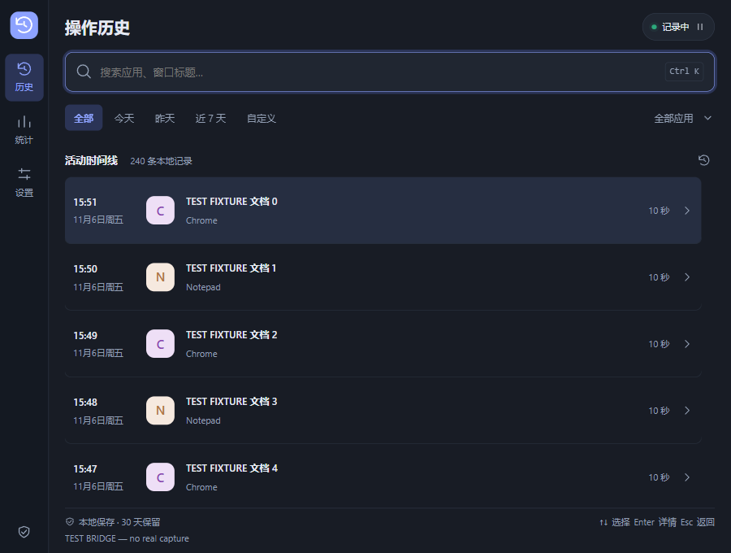

# 操作历史 · utools-history

找回你在电脑上做过的事。面向 Windows 的 uTools 本地活动历史插件，使用真实 Win32 前台窗口采样，不需要账号、AI 或云端服务。

**当前为可加载测试的开发预览版，尚未正式发布。** M2/M3 主流程及 M4 自动化检查已实现，Windows/uTools 集中实机验收见 [人工验证清单](docs/manual-verification.md)。不承诺全天记录或精确工时。

## 已实现

- 首次明确同意后，每秒采集应用进程名、窗口标题与时间；已同意且未暂停时，下次加载自动恢复。
- SQLite 本地持久化、重复窗口合并、空闲/安全桌面与长采样间断分段。
- 虚拟化时间线、即时关键词搜索、应用筛选、今天/昨天/近 7 天/自定义日期、分页。
- ↑↓ 选择、Enter 详情、Esc 返回、Ctrl/Cmd+K 搜索；复制标题、按应用统计。
- 暂停/恢复、应用排除、单条/范围/全部删除确认、1–3650 天保留期限。
- 本地 JSON/CSV 导出（CSV 公式前缀转义）、深色/浅色/跟随系统主题。

不截屏、不录按键、不读剪贴板，不抓取网页正文。窗口标题可能含敏感信息，请先设置排除应用；排除不会删除已有历史。没有可信 URL/路径时不提供虚假的“重新打开”。

## 界面截图

以下是自动化 UI 测试截图，**含明确标记的 TEST FIXTURE 测试记录，不是用户真实历史或宿主验收证据**。正常产品没有演示数据注入。




首次使用现为紧凑隐私说明，无需滚动即可开始记录；启用后进入时间线并聚焦搜索。已覆盖 800×544、600×400、480×360 CSS 窗口和 DPR 1/1.25/1.5 浏览器模拟，不能替代 Windows/uTools 的真实显示缩放测试。见 [渲染修复记录](docs/rendering-review.md)。

## 安装与运行

需要 Windows 10/11、uTools 开发者工具；开发使用 Node.js **22.18+**（本次验证为 24.18）与 npm。uTools 内置 Node/Electron 的实际兼容性仍需宿主验证，存储不依赖原生 SQLite ABI。

```sh
npm ci
npm run check
```

生产预览：在 uTools 开发者工具导入绝对路径 `dist/plugin.json`，搜索 **操作历史**。构建自动移除开发服务器配置，并包含 preload、采集脚本、SQLite WASM 及第三方许可。也可解压 `artifacts/utools-history-windows-preview.zip` 后导入其中的 `plugin.json`；这是开发者加载包，尚非商店安装包。

开发热更新：执行 `npm run dev` 后导入 `public/plugin.json`。开发地址固定为 `http://127.0.0.1:5197`，与观市使用的 5173 分离；若 5197 被占用则明确失败，不自动换端口。更新后请在 uTools 开发者工具重新导入或刷新插件配置，结束旧实例后再打开。普通浏览器仅显示宿主不可用提示，不生成虚假历史。

## 检查命令

```sh
npm run check          # 模块测试、类型检查、生产构建、产物校验
npx playwright install chromium
npm run test:ui        # 浏览器交互测试；仅测试中注入 fixtures
npm run test:windows   # 真实 Win32→SQLite、暂停、重开及打包 preload
npm run benchmark     # 10 万条临时测试记录的基础性能
```

已有 Edge 时，可设置环境变量 `PW_CHANNEL=msedge` 运行 UI 测试。Windows 集成测试会短暂读取真实前台标题，只写临时目录并在结束后删除；结果报告不含标题。详见 [测试结果](docs/test-results.md)。

## 数据与运行范围

数据库：`utools.getPath('userData')/HostXit/utools-history/history.sqlite`，实际目录在设置中显示。首次同意前不采集；暂停设置持久保存。退出界面后，只要插件进程仍存活就继续采集；结束插件或完全退出 uTools 后停止。不注册服务或开机启动。宿主是否保活以人工验收为准。

数据库每 5 秒原子保存一次，设置/删除与正常退出即时保存。进程崩溃可能损失最近约 5 秒；不跨重启补算时长。数据库未加密；删除并非磁盘安全擦除，导出文件需要自行管理。SQLite WASM 将数据库载入内存，大型历史的长期占用仍需实测。

## 架构与维护

Vue 3 UI → 类型化 preload 接口 → 独立协调服务 → 可替换采集适配器 / SQLite repository。

- [架构、数据结构与决策](docs/architecture.md)
- [人工验证清单](docs/manual-verification.md) · [测试计划](docs/test-plan.md)
- [贡献指南](CONTRIBUTING.md) · [变更记录](CHANGELOG.md) · [发布流程](docs/releasing.md)
- [产品规划与里程碑状态](Plan.md)

保留真实 Git 历史，每个独立变更通过检查后使用 Conventional Commits 提交。未正式发布，不创建产品版本标签；未经授权不推送。项目开源许可证尚未由维护者选定，不应假定授权；打包的 sql.js MIT 许可随产物提供。
